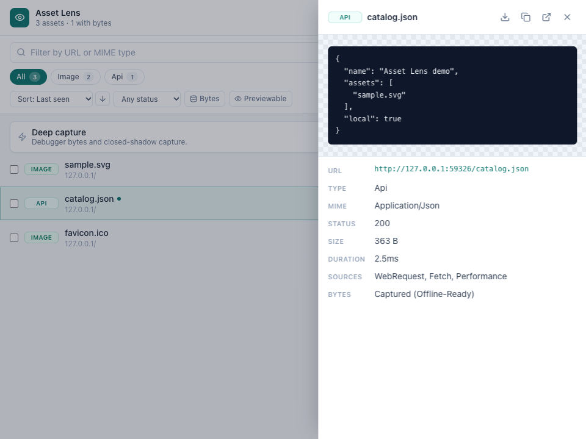

# Asset Lens

[](https://github.com/Amal-David/asset-capture/actions/workflows/test.yml)

A Chrome extension that finds the assets a web page loads, lets you inspect them, and saves individual files or an export of the session. It includes images, video, audio, fonts, 3D models, API responses, and assets created at runtime.

**[Install locally →](#quick-start)** · **[Report a problem](https://github.com/Amal-David/asset-capture/issues)**

Captured data is stored in your browser. There is no account, backend, or analytics. Previews and downloads can contact the servers hosting the assets; see [Privacy](#privacy).



## Contents

- [Features](#features)
- [Quick start](#quick-start)
- [Usage](#usage)
- [Preview support](#preview-support)
- [Export formats](#export-formats)
- [Capture coverage](#capture-coverage)
- [Permissions](#permissions)
- [Privacy](#privacy)
- [Limitations](#limitations)
- [Troubleshooting](#troubleshooting)
- [Development](#development)
- [Project structure](#project-structure)
- [Documentation](#documentation)
- [Credits](#credits)
- [License](#license)

## Features

- **Find page assets.** Combine network metadata, DOM and CSS references, and runtime events into one record per URL in each tab session.
- **Inspect before saving.** Preview supported images, media, fonts, JSON, text, glTF/GLB models, PDFs, and ZIP file listings.
- **Narrow the list.** Search by URL, MIME type, or capture source; filter by type, domain, HTTP status, captured bytes, or previewable category.
- **Pick from the page.** Use the element picker to find the asset behind a visible element.
- **Save files or metadata.** Download individual assets, copy URLs, or export JSON, CSV, HAR, URL lists, and ZIP archives.
- **Inspect streams.** Read HLS and DASH manifest details and try playback of unencrypted HLS streams when supported.

## Quick start

You need Chrome and Node.js 22.12 or newer. From a terminal:

```bash
git clone https://github.com/Amal-David/asset-capture.git
cd asset-capture
npm ci
npm run build
```

Then in Chrome:

1. Open `chrome://extensions` and turn on **Developer mode**.
2. Click **Load unpacked** and choose the repository's `dist` folder.
3. Open the page you want to inspect and click the **Asset Lens** extension icon to open its side panel. Alternatively, open DevTools and select the **Asset Lens** panel.
4. Reload the page with the panel open, then scroll or interact with it to load more assets.
5. Click an asset to preview it. Use **Download** in the preview, or the header's export menu to save a session export.

This installs the extension from source. Rebuild and click **Reload** on its card at `chrome://extensions` after changing the code. Reload the inspected page too so it receives the updated capture scripts.

## Usage

### Find and inspect

The side panel follows the active tab in its window. The DevTools panel stays attached to the tab being inspected. Records belong to a tab session, so navigating in that tab can leave earlier assets in the list; use **Clear session** when you want to start over.

- **Type chips** support multiple selections. **All** clears the type filter.
- **Bytes** shows assets with a stored body. Finding a URL does not mean its file contents were captured.
- **Previewable** filters by asset category; decoding can still fail.
- **Rescan page** searches the current DOM, stylesheets, and available page history again. **Refresh** only reloads stored results for an already active session.
- **Pick an asset from the page** activates the element picker. Press Escape to cancel.
- **Keyboard:** focus the asset list, use Up/Down to move, Enter to preview, and Space to select for bulk actions.

### Save assets

Open a preview or right-click a row for **Download**, **Copy URL**, **Open in new tab**, and **Copy as data URL** when bytes are available.

Check rows to show the bulk toolbar. Its count, downloads, copied URLs, and ZIP export use the selected rows visible under the current filters. **Select all** selects all filtered results, including rows outside the visible scroll area.

The header's **Export all captured assets** menu exports the entire tab session, regardless of filters. [Export formats](#export-formats) explains what each output contains.

For model conversion, download the file and open it in [meshy2glb](https://github.com/Amal-David/meshy2glb). Asset Lens discovers and saves assets; it does not convert models.

### Optional deep capture

**Attach** requests Chrome's optional debugger permission for the inspected tab. This enables additional response-body capture and lets the extension open shadow roots created after attachment. **Detach** disconnects the debugger.

Deep capture can affect page behavior and conflict with DevTools or another debugger. It cannot recover every response or open shadow roots that already exist. Detaching does not close roots already opened by this mode; reload the page to restore its normal behavior.

## Preview support

| Asset | What appears in the preview |
| --- | --- |
| Images | Browser-supported formats; unsupported formats show a download card. |
| Video and audio | Browser media player after a successful load probe. Codec and access restrictions still apply. |
| Fonts | Sample text rendered with the font. |
| JSON, APIs, CSS, manifests, subtitles | Text, with JSON formatting where possible. Display is limited to 20,000 characters. |
| glTF / GLB | Interactive model preview through bundled `model-viewer`. Companion files may be needed. |
| PDF | Embedded PDF viewer when Chrome supports it in the extension page. |
| ZIP | Up to 500 entry names and uncompressed sizes, without extracting entries. |
| Other files | Metadata and download/open actions. |

Captured bytes are preferred when available. Otherwise a preview may request the original URL. Expired URLs, missing companion files, unsupported codecs, or unavailable bytes can prevent a preview even when metadata was captured.

## Export formats

| Format | Contents |
| --- | --- |
| JSON | Session ID and asset metadata. No file bodies. |
| CSV | Asset ID, type, MIME, status, size, URL, sources, and redaction flags. |
| URL list | One redacted URL per line. Signed links may no longer work after redaction. |
| HAR | One entry per asset URL, using the latest retained request's headers. No response bodies; timings are approximate and unknown HTTP versions are left blank. |
| ZIP | Asset files, `metadata.json`, `requests.har`, and `failures.json`. Stored bytes are used first; missing files are fetched without cookies. |

ZIP exports can be partial. Check the failure count in the panel and `failures.json` in the archive. A successful export means Chrome accepted the download request; it does not confirm the file has finished saving.

## Capture coverage

| Source | Coverage |
| --- | --- |
| Network | Request metadata from `webRequest`; page-level fetch/XHR hooks can also supply response bytes. |
| DOM and CSS | Asset attributes, lazy-load references, `srcset`, inline styles, accessible stylesheets, and open shadow roots. |
| Runtime objects | Blob and data URLs, canvas exports, font loads, and some MediaSource segments. |
| Page history | Available resource timing and a bounded buffer of recent hook metadata, replayed on inspection or rescan. |
| Deep capture | Additional debugger response bodies and future shadow roots on the attached tab. |

Capture scripts run at document start on matching pages. Persistent recording of ordinary capture messages is gated to tabs with a recently active inspector or capture action. Page hooks and bounded metadata buffering can run before inspection begins; earlier response bodies are not replayed. Reload with the panel open for the best chance of capturing bytes.

## Permissions

The extension currently requests broad host access (`<all_urls>`), not per-site optional access. Chrome can restrict site access in the extension's settings; capture on those sites then depends on the access you allow.

| Permission | Purpose |
| --- | --- |
| Host access and `webRequest` | Observe page requests and fetch assets for inspection or export. |
| `tabs`, `activeTab` | Identify inspected tabs and follow tab changes. |
| `scripting` | Apply page instrumentation used by deep capture. |
| `sidePanel` | Display the inspector beside the page. |
| `downloads` | Save files and exports through Chrome. |
| `storage` | Declared in the manifest; captured records currently use IndexedDB. |
| Optional `debugger` | Enable deep capture after a permission request. |

## Privacy

- Captured records and bodies are stored in local IndexedDB. Closing a tab triggers deletion; browser startup attempts to remove orphaned sessions. **Clear session** removes that tab's stored capture.
- The extension has no analytics or backend and does not upload captures to a project server.
- Previews, manifest inspection, playback, downloads, and ZIP fallback requests can contact asset hosts. Text and ZIP fallback fetches omit cookies. Direct downloads use Chrome's download behavior and may include cookies for the target host.
- Recognized sensitive headers and secret patterns in text bodies are redacted before storage. Original URLs remain in local records and ordinary **Copy URL** actions. Export metadata redacts recognized sensitive URL parameters and credentials.
- Redaction is best-effort. It does not remove every secret, personal detail, or sensitive value, and it does not sanitize binary files. Review exports before sharing them.

See [PRIVACY.md](PRIVACY.md) for the full policy. Only save assets you own or have permission to use.

## Limitations

- **Not every asset is recoverable.** Browser-internal pages, the Chrome Web Store, inaccessible frames/stylesheets, worker-only activity, and unavailable response bodies can limit capture.
- **Very early responses can be missed.** The page hook can run before the content-script bridge finishes loading. A fast startup response may have metadata but no stored bytes; repeat the page action after inspection starts when possible.
- **16 MiB per captured body.** Larger bodies are skipped. ZIP fallback downloads have the same per-file cap. This is not a total session or archive budget.
- **Streams are not complete recordings.** MSE capture is capped and can contain incomplete or mixed segments. Asset Lens does not decrypt DRM, merge adaptive streams, or guarantee a playable video download.
- **Bounded request history.** Old request events are periodically pruned toward 5,000 per session. A long session may no longer have headers for its earliest assets.
- **ZIP exports use memory.** Files are assembled and compressed in memory; exporting a large session can be slow or use substantial RAM. Prefer smaller selections.
- **Preview support is narrower than detection.** Detecting a model, archive, or media URL does not guarantee it can render inline.

## Troubleshooting

| Problem | What to try |
| --- | --- |
| No assets appear | Use a regular web page, check Chrome's site-access setting, and reload with the panel open. Internal Chrome pages cannot be inspected. |
| A blob says “Bytes not captured” | Reload with the inspector open and repeat the action that creates the blob. Rescanning can recover metadata, not past bytes. |
| A URL downloads but will not preview | Check its format and companion files. Download it and inspect it in a tool that supports the format. |
| ZIP reports failures | Open `failures.json`. Private, expired, browser-local, or oversized files can fail; select fewer files or capture their bytes first. |
| Deep capture will not attach | Accept the optional permission and close other debuggers attached to that tab. Some pages cannot be attached. |
| A stream fails to play | The stream may require cookies, use an unsupported codec, or be encrypted. Manifest detection does not guarantee playback. |
| Old assets remain after navigation | Capture is per tab session. Use **Clear session**, then reload or rescan. |

## Development

```bash
npm ci
npm test                         # unit, store, UI, and database regression tests
npm run typecheck
npm run build                    # production extension in dist/
npx playwright install chromium
npm run test:browser              # builds, then tests the extension against local pages
npm audit                        # includes development dependencies
npm run package:chrome           # versioned ZIP in submission/chrome-web-store/
```

`npm run dev` starts Vite for extension development; it is not a standalone web version of the app. Main-world capture hooks require rebuilding/reloading for reliable verification. No extra page-message permissions are added for hot reload.

The browser smoke test uses an isolated Chromium profile, the built extension, and locally served fixtures. It checks capture, JSON preview, tab switching, filtering, focus, and a 1,000-asset list. Run `UPDATE_SCREENSHOTS=1 npm run test:browser` to refresh the README screenshot from that fixture.

[CI](.github/workflows/test.yml) runs tests, the build, and the browser smoke test on pushes and pull requests. The [review report](docs/REVIEW.md) records verification limits and remaining dependency work.

## Project structure

```text
src/
  manifest.ts                   Chrome permissions and entrypoints
  background/service-worker.ts  Capture storage, messages, downloads, debugger
  content/                      Page hooks, DOM/CSS discovery, element picker
  sidepanel/                    React inspector and session state
  popup/                        Compact inspector entrypoint
  devtools/                     DevTools panel entrypoints
  shared/                       Types, database, classification, redaction, exports
  styles/                       Shared styles
public/icons/                   Extension icons
tests/                          Regression tests and fixtures
scripts/browser-smoke.mjs       Chromium extension smoke test
docs/                           Review report and screenshots
submission/                     Chrome Web Store submission material
```

## Documentation

| Document | Contents |
| --- | --- |
| [PRIVACY.md](PRIVACY.md) | Local storage, network requests, redaction, permissions |
| [docs/REVIEW.md](docs/REVIEW.md) | Engineering/product review, fixes, evidence, follow-ups |
| [submission/](submission/) | Store submission material; not proof of publication |

## Credits

- [React](https://react.dev/) and [Zustand](https://github.com/pmndrs/zustand): inspector UI and state
- [Dexie](https://dexie.org/): IndexedDB access
- [fflate](https://github.com/101arrowz/fflate): ZIP exports and entry listing
- [model-viewer](https://modelviewer.dev/) and [hls.js](https://github.com/video-dev/hls.js): model and HLS previews
- [Lucide](https://lucide.dev/), [Tailwind CSS](https://tailwindcss.com/), [Vite](https://vite.dev/), and [CRXJS](https://crxjs.dev/): icons, styles, and extension build tooling

## License

This repository does not currently declare a project license. Dependency licenses apply to their respective packages; they do not grant a license to this project's code.
